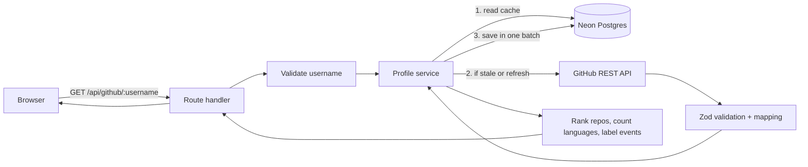

# Builder Card

Enter a GitHub username and get a one-page developer profile: public profile, top repositories, main languages, and recent public activity. Data comes from the GitHub REST API and is cached in a Neon PostgreSQL database.

> Shows **public** GitHub information only. "Recent activity" is a short window of public events, not a complete history, and never includes private work.

## Features

- Profile: avatar, name, username, bio, location, repo/follower/following counts, link to GitHub.
- **Top Repositories by Stars**: up to five, ranked by stars (ties: name A–Z, then repository ID). Forks are excluded.
- **Languages Across Public Repositories**: how many repositories list each language as their primary language. This is *not* a share of code written.
- **Recent Public Activity**: up to ten events, with explicit handling for known event types and a generic label for unknown ones.
- Neon-backed cache (default 15 minutes), a Refresh button, and a visible banner saying whether data is live, cached, or stale.
- Loading skeleton, and clear messages for invalid usernames, unknown users, rate limits, network errors and empty results.

## Tech stack

| Area | Choice (version installed) |
|---|---|
| Framework | Next.js 16.4.3, App Router |
| UI | React 19.3.1, Tailwind CSS 4.3.3, lucide-react 1.65.0 |
| Language | TypeScript 6.0.3 (`strict`) |
| Database | Neon serverless Postgres via `@neondatabase/serverless` 1.2.0 |
| ORM | Drizzle ORM 0.45.4 + Drizzle Kit 0.31.11 |
| Validation | Zod 4.6.7 |
| Tests | Vitest 5.0.5 |
| Lint | ESLint 9.39.5 + eslint-config-next 16.4.3 |

**Version note:** npm's latest TypeScript is 7.x, but `typescript-eslint` (used by `eslint-config-next`) only supports TypeScript below 6.1, so TypeScript is pinned to 6.0.3. ESLint is pinned to 9.x for the same compatibility reason. Re-check both when you upgrade.

## Architecture



Responsibilities are kept in separate files: `route.ts` (HTTP), `validation.ts` (input), `github/client.ts` (GitHub), `logic.ts` (ranking/aggregation/cache rules), `profile-service.ts` (the flow), `db/queries.ts` (SQL), `components/` (UI).

### What happens on a search

1. Username is validated (1–39 chars, letters/digits/single hyphens).
2. Neon is checked for saved data. If it is younger than the TTL and this is not a refresh, it is returned immediately (`source: "cache"`). No GitHub call, no database write.
3. Otherwise GitHub is called: profile first (an unknown user costs one request), then repositories and events in parallel.
4. Every response is validated with Zod before use.
5. The result is saved in **one atomic batch**: upsert profile, delete repos/events that no longer exist, upsert repos, insert new events.
6. The ranked, labelled result is returned.

### Failure behaviour

| Situation | What happens |
|---|---|
| `DATABASE_URL` missing | `503 DATABASE_NOT_CONFIGURED` with a setup message. Nothing pretends to be saved. |
| User does not exist | `404 USER_NOT_FOUND`. Cached data is not served. |
| GitHub rate limit (403 with 0 remaining, or 429) | If saved data exists: it is shown with `source: "stale-cache"` and a warning. If not: `429 RATE_LIMITED` with `retryAfterSeconds`. |
| GitHub down / timeout / bad JSON | Same fallback as above, otherwise `502 GITHUB_UNAVAILABLE`. |
| GitHub OK but database **write** fails | Live data is still returned with `meta.persisted: false` and a warning. It is not cached. |
| Database **read** fails | Logged, then GitHub is called as if nothing was cached. |
| Neither works | Error response. |

### Caching policy

- Fresh window: `CACHE_TTL_MINUTES` (default **15**).
- Refresh button: bypasses the TTL, but data fetched under **60 seconds** ago is still reused (`REFRESH_COOLDOWN_MS` in `src/lib/config.ts`) to protect the rate limit.
- Identical simultaneous requests on one server instance share one in-flight promise. This is deduplication, not a cache; the database is the only cache, so it works across serverless instances.
- Stale data is never silently shown: the banner says where data came from and how old it is.
- API responses are sent with `Cache-Control: no-store`, because the database is the cache.

## Prerequisites

Node.js 20.9 or newer (developed on Node 22), npm, a free [Neon](https://neon.com) account, and optionally a GitHub account for a token.

## Setup

```bash
npm install
cp .env.example .env.local     # then edit .env.local
```

### Create the Neon database

1. Sign in at the Neon console and click **New project**. Pick a name and region.
2. On the project dashboard click **Connect** and copy the connection string.
3. Paste it into `.env.local` as `DATABASE_URL=...`.

### Environment variables

| Variable | Required | Purpose |
|---|---|---|
| `DATABASE_URL` | **Yes** | Neon connection string. |
| `GITHUB_TOKEN` | No | Server-side personal access token. Raises GitHub's limit from 60 to 5,000 requests/hour. No scopes needed for public data. Never exposed to the browser. |
| `CACHE_TTL_MINUTES` | No | Cache freshness window. Default 15. |

Create a token under GitHub → Settings → Developer settings → Personal access tokens.

### Create the tables

The migration is committed in `drizzle/`. Apply it to your Neon database:

```bash
npm run db:migrate
```

After you change `src/lib/db/schema.ts`, run `npm run db:generate` to create a new migration file, review the SQL, commit it, then `npm run db:migrate`.

### Run

```bash
npm run dev          # http://localhost:3000
```

### Check

```bash
npm run typecheck
npm run lint
npm test
npm run build      
```

## Tests

`npm test` runs 57 unit tests with no network: username validation, ranking, language aggregation, event formatting, missing profile fields, empty repository lists, GitHub error mapping (404, 403/429 rate limits, 5xx, network failure, malformed JSON), pagination limit, token handling, cache freshness, and the service's cache/fallback/save-failure paths (GitHub and database are mocked).

**Database integration testing strategy:** unit tests do not touch a database. To test SQL for real, point `DATABASE_URL` at a throwaway Neon branch (Neon branches are cheap), run `npm run db:migrate`, and exercise `saveCard` / `readCachedCard`. During development the migration and these two functions were also checked against an in-process Postgres (PGlite); that check was a temporary script and is not part of the repo.

## Deploy to Vercel

1. **GitHub repo:** create an empty repository on GitHub, then:
   ```bash
   git remote add origin https://github.com/<you>/builder-card.git
   git branch -M main
   git push -u origin main
   ```
2. **Migrate the production database** *before* the first deploy (from your machine, with the production string):
   ```bash
   DATABASE_URL="<neon connection string>" npm run db:migrate
   ```
   If you use one Neon database for local and production, you already did this.
3. In Vercel: **Add New → Project**, import the repository. Framework preset: Next.js (auto-detected). Leave build settings at defaults.
4. Under **Environment Variables** add `DATABASE_URL` (required) and `GITHUB_TOKEN` (recommended). Do not prefix them with `NEXT_PUBLIC_`.
5. Click **Deploy**.
6. Test the deployed URL: search `srnsksyp`, search again (banner should say saved data), click Refresh, search `this-user-does-not-exist-zz9`, search `-bad`.

Migrations are run manually rather than during the Vercel build so a failed migration cannot silently half-deploy. Vercel's free tier has usage limits that change over time; check Vercel's current pricing page.

## API

`GET /api/github/:username?refresh=1`  (`refresh` is optional)

Success `200`:

```json
{
  "ok": true,
  "data": {
    "profile": { "githubId": 583231, "username": "srnsksyp", "name": null, "avatarUrl": "…", "bio": null, "location": null, "publicRepos": 8, "followers": 0, "following": 0, "profileUrl": "…" },
    "topRepositories": [ { "githubId": 1, "name": "…", "fullName": "…", "description": null, "language": null, "stars": 0, "forks": 0, "url": "…" } ],
    "languageSummary": { "languages": [ { "language": "Go", "repositories": 3 } ], "otherLanguages": 0, "reposWithLanguage": 3, "reposWithoutLanguage": 1 },
    "events": [ { "githubEventId": "…", "type": "PushEvent", "label": "Pushed commits", "repoName": "…", "detail": "2 commits to main", "createdAt": "…" } ],
    "meta": { "source": "github", "fetchedAt": "…", "persisted": true, "warning": null, "repositoriesAnalyzed": 4 }
  }
}
```

(The values above are illustrative, not real data.)

Errors: `{ "ok": false, "error": { "code": "…", "message": "…", "retryAfterSeconds": 123 } }`

| Status | `code` |
|---|---|
| 400 | `INVALID_USERNAME` |
| 404 | `USER_NOT_FOUND` |
| 429 | `RATE_LIMITED` (also sets `Retry-After`) |
| 502 | `GITHUB_UNAVAILABLE` |
| 503 | `DATABASE_NOT_CONFIGURED` |
| 500 | `INTERNAL_ERROR` |

## GitHub rate limits

Unauthenticated: 60 requests/hour per IP (shared by everyone behind the same IP, including Vercel's outbound addresses). With a token: 5,000/hour. One uncached search costs 3 requests, plus up to 2 more for users with over 100 repositories. The cache, the refresh cooldown and the profile-first ordering all exist to save requests. For any real traffic, set `GITHUB_TOKEN`.

## Known limitations

- Only the 300 most recently updated repositories (3 pages of 100) are read. A very popular old repository could be missed for users with more than 300.
- Forks are excluded from ranking and language counts; "Public repos" in the header is GitHub's total, which includes forks.
- Language chart counts repositories, not bytes of code.
- Events are a limited window of public events as returned by GitHub, and `PushEvent` detail depends on what GitHub includes in the payload.
- There is no per-IP rate limiting on this app's own API.
- A GitHub username rename creates no duplicate (rows are keyed by GitHub's numeric ID), but lookups by the *old* name only work until someone else takes it.
- Neon free-tier compute can suspend when idle, so the first request after a quiet period may be slower.
- Not security-audited. Basic measures only: input validation, parameterized queries, server-side secrets, no stack traces to clients, escaped output.

## Troubleshooting

| Symptom | Fix |
|---|---|
| `DATABASE_NOT_CONFIGURED` | Create `.env.local` with `DATABASE_URL`, restart `npm run dev`. |
| `relation "github_profiles" does not exist` | Run `npm run db:migrate`. |
| Always `RATE_LIMITED` | Add `GITHUB_TOKEN`, or wait for the reset time in the message. |
| `warning: could not be saved` | Check `DATABASE_URL`, check the Neon project is not paused, read the server log. |
| `npm run db:migrate` fails to connect | Confirm the string ends with `?sslmode=require`. If you used the pooled string, try the direct one from the Neon Connect dialog. |
| Avatar missing | Only `avatars.githubusercontent.com` is allowed in `next.config.ts`. |
